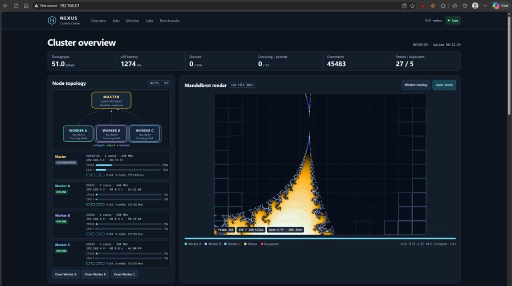
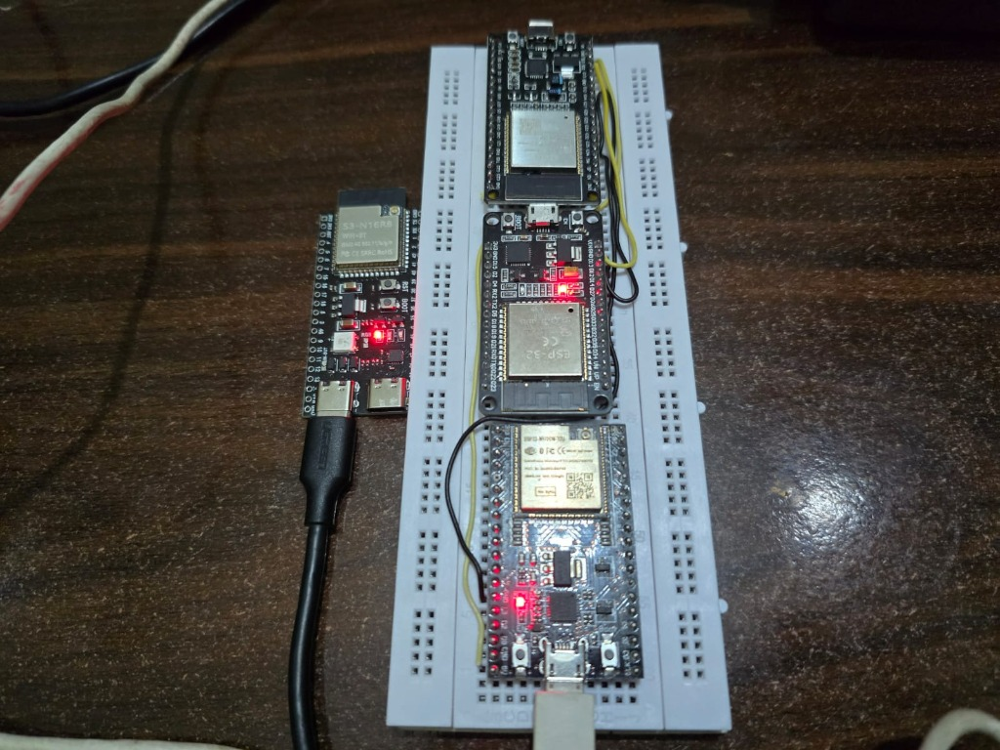
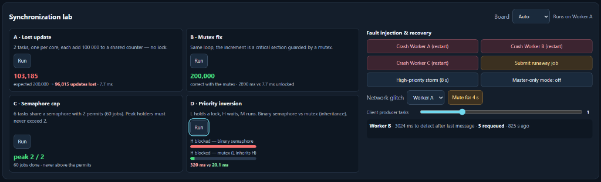

# NEXUS — Multithreaded Distributed Task Orchestration Engine on FreeRTOS

**CS-2006 Operating Systems · Project #2 (Cloud Task Orchestration Engine)**  
FAST – National University of Computer and Emerging Sciences (Karachi Campus) · Department of Cyber Security · Fall 2026

| Field | Details |
| --- | --- |
| **Team** | Muhammad Hasnain Memon (`24K-2001`, Leader) · Akbar Hussain (`24K-2026`) · Ateeb Ahmed Qureshi (`24K-2036`) |
| **Section & Instructor** | `BCY-5A` · Sandesh Kumar |
| **Stack** | **C11** · **ESP-IDF v6.1** · **FreeRTOS SMP** · Vanilla HTML/CSS/JS (gzipped in flash, zero Python) |
| **Hardware Cluster** | 1× `ESP32-S3-N16R8` Master + 3× `ESP32-D0WD-V3` Workers (**4 boards · 8 active CPU cores**) |
| **Final Report** | [NEXUS_OS_Project_Report.pdf](report/NEXUS_OS_Project_Report.pdf) (14 pages) |

---

## Overview

NEXUS is a C11 and FreeRTOS task orchestration engine running across an offline four-board ESP32 cluster with no external router, Raspberry Pi, cloud dependency, or Python runtime.

- **Within each board (shared memory / threads):** A reusable node engine (`firmware/components/nexus_core/`) implements a bounded producer-consumer job queue guarded by a mutex and two counting semaphores, a fixed pool of `N = 4` executor tasks regulated by a live-adjustable counting-semaphore permit cap (`K = 1..4`), non-blocking ring logging, sampled FreeRTOS task monitoring, and an interactive synchronization laboratory (Labs A–D).
- **Across boards (separate address spaces / message passing):** The ESP32-S3 master hosts a 20 MHz WPA2 Wi-Fi SoftAP (`NEXUS-OS`, `192.168.4.1`), schedules jobs across three dual-core ESP32 workers via framed binary TCP messages (`NX` v1 on port `5005`), detects failures through 500 ms heartbeats and per-job leases, and automatically requeues unfinished work with **at-least-once execution** and **exactly-once commit** semantics.
- **Single-Node Mode:** The master can run the entire engine locally on its own dual-core pool with zero network traffic, demonstrating every OS mechanism on a single board.
- **Embedded Offline Control Center:** A single-page dashboard (`21,959` bytes gzipped in master flash) streams live telemetry over WebSockets (`4 Hz` active / `2 Hz` idle) and renders distributed 600×400 Mandelbrot fractal frames tile by tile so scheduling order, load balance, contention, and failure recovery are immediately visible.



---

## Hardware Architecture (4 Boards · 8 Active Cores)

All four physical boards run dual-core FreeRTOS (`CONFIG_FREERTOS_UNICORE` disabled). All three classic workers run the exact same compiled image; the master assigns roles `A`, `B`, and `C` in join order and binds each slot to the board's 6-byte factory MAC across reconnects.

| Role | Board | Verified Chip & Memory | Factory MAC | Network Role |
| --- | --- | --- | --- | --- |
| **Master** | ESP32-S3-N16R8 | Dual-Core Xtensa LX7 240 MHz, 16 MB flash, 8 MB octal PSRAM | `e0:72:a1:d6:f1:f4` | SoftAP `192.168.4.1`, TCP `:5005`, HTTP/WS `:80` |
| **Worker (Slot A)** | ESP32-WROOM-32U | ESP32-D0WD-V3 Dual-Core 240 MHz, 4 MB flash, 520 KB SRAM | `14:2b:2f:da:a1:68` | STA DHCP (`WIFI_PS_NONE`), `N = 4`, boot `K = 2` |
| **Worker (Slot B)** | ESP32 DevKit #2 | ESP32-D0WD-V3 Dual-Core 240 MHz, 4 MB flash, 520 KB SRAM | `8c:94:df:90:c9:68` | STA DHCP (`WIFI_PS_NONE`), `N = 4`, boot `K = 2` |
| **Worker (Slot C)** | ESP32 DevKit #1 | ESP32-D0WD-V3 Dual-Core 240 MHz, 4 MB flash, 520 KB SRAM | `78:42:1c:6c:00:f4` | STA DHCP (`WIFI_PS_NONE`), `N = 4`, boot `K = 2` |

<p align="center">
  
</p>

---

## Operating System Concepts Implemented

| Course Item | Mechanism & Implementation | Key Source Files |
| --- | --- | --- |
| **M1 · Shared Job Queue** | 256-slot bounded producer-consumer buffer with `q_mtx`, `sem_free`, and `sem_ready` (OSC 10e §7.1.1) | `firmware/components/nexus_core/job_queue.c` |
| **M2 · Fixed Worker Pool** | `N = 4` reusable executor tasks created once at boot across both cores (OSC 10e §4.5.1) | `firmware/components/nexus_core/exec_pool.c` |
| **M3 · Semaphore Slots** | Counting semaphore `sem_slots` enforces live permit cap `K = 1..4` with graceful permit retirement (OSC 10e §6.6) | `firmware/components/nexus_core/exec_pool.c` |
| **M4 · Completion Reporting** | Job state machine (`QUEUED → DISPATCHED → RUNNING → DONE / FAILED / CANCELLED`), CRC32 checks, duplicate rejection | `firmware/components/nexus_core/job_queue.c`, `firmware/master/main/stats.c` |
| **A1 · Priority Scheduling** | 3 orderings (`FCFS`, `Strict Priority`, `Priority + Aging` at +1 per 1.5 s) × 2 placements (`Round-Robin`, `Least-Loaded`) | `firmware/components/nexus_core/job_queue.c`, `firmware/master/main/cluster.c` |
| **A2 · Timeouts & Fault Recovery** | 500 ms heartbeats, `SUSPECT` at 1.5 s, `OFFLINE` at 3.0 s, per-job leases (`budget + 2 s`), cooperative cancel, 3-attempt cap | `firmware/master/main/cluster.c`, `firmware/components/nexus_core/kernels.c` |
| **A3 · Dynamic Scaling** | Live `SET_SLOTS` with correlated worker ACK, graceful worker drain, and authoritative Single-Node Mode | `firmware/master/main/cluster.c`, `firmware/components/nexus_core/proto.h` |
| **A4 · Logging & Monitoring** | Non-blocking 64-entry `log_queue` logger; sampled `uxTaskGetSystemState()` task table & per-core CPU load | `firmware/components/nexus_core/logger.c`, `monitor.c` |
| **A5 · Statistics & Benchmarks** | 4,096-job master-clock commit ring, p95 latency, scripted suites `T1–T5`, and `/api/runs.csv` + `/api/csv` export | `firmware/master/main/stats.c`, `experiments.c` |
| **O8 · Synchronization Lab** | On-hardware Labs A–D: lost-update race, mutex protection, 2-permit semaphore cap, and priority inheritance (OSC 10e §6.8.2) | `firmware/components/nexus_core/oslab.c` |

**Deadlock Prevention (OSC 10e §8.5):** Subsystem mutexes (`q_mtx`, `nodes_mtx`, frame `s_fmtx`, stats `s_mtx`) are never held concurrently, and all blocking acquisitions follow the strict acyclic partial order `sem_free / sem_ready → sem_slots → q_mtx`.

---

## Measured Physical Hardware Results

### 1. Sustained Four-Board Operation & Fault Recovery
- **Long-run stability:** Over 22+ minutes of continuous operation, the cluster committed **46,692 jobs** with **0 permanent failures**, **27 automatic retries**, and **5 late duplicates cleanly discarded** by `jq_commit()`.
- **Bounded-buffer contention:** Master queue logged **504,729 mutex acquisitions** with **4% contention** and **99 blocked producer waits** on `sem_free`.
- **Load balance:** Completed Mandelbrot Frame 265 (150 tiles, 5.7× zoom, 205 iterations) in **1.4 s** split evenly across workers (**A: 52 · B: 51 · C: 47 · M: 0**).
- **Crash detection:** Live Worker B fault detected in **3,024 ms** after last message with **5 in-flight jobs automatically requeued**.
- **Memory stability:** Steady-state free RAM held at **7,751 KB** on the ESP32-S3 master and **153 KB** on every classic ESP32 worker under full Wi-Fi/TCP load; dual-core QEMU self-tests confirmed **0 bytes heap leak** across repeated renders and identical cross-target CRCs (`overview=89c14f24`, `detail=4208557d`, `matmul=af160840`).

### 2. Synchronization Laboratory (Live on Physical Worker A)

| Lab | Scenario | Physical Hardware Result |
| --- | --- | --- |
| **Lab A** | 2 tasks (Core 0 & Core 1) × 100,000 unlocked increments | **103,185 / 200,000** (**96,815 updates lost**, 48.4% data loss in 7.7 ms) |
| **Lab B** | Same loop protected by a FreeRTOS mutex | **200,000 / 200,000** (100% exact, 2,890 ms locking cost) |
| **Lab C** | 6 tasks sharing 2 semaphore permits (60 jobs) | **60 / 60 jobs**, verified **peak 2 / 2** |
| **Lab D** | Priority inversion on Core 1 (Binary Sem. vs. Mutex PI) | **320 ms vs. 20.1 ms** (**15.9× reduction** in high-priority wait) |



### 3. Suite T5 Scaling Benchmarks (21 Physical Runs, 100 Seeded `MATMUL` Jobs, `K = 2`)

| Configuration | Trials | Mean Throughput | Mean p95 Latency | Mean Makespan | Remote Speedup | Typical Split (`M/A/B/C`) |
| --- | :---: | ---: | ---: | ---: | ---: | --- |
| `n=12` · Master-only (`0W`) | 2 | 1,545.2 jobs/s | 71.0 ms | 0.115 s | — (local) | `100 / 0 / 0 / 0` |
| `n=12` · `1 Worker` | 2 | 123.1 jobs/s | 780.5 ms | 0.815 s | 1.00× | `0 / 100 / 0 / 0` |
| `n=12` · `2 Workers` | 3 | 221.1 jobs/s | 419.3 ms | 0.453 s | 1.80× | `0 / 50 / 50 / 0` |
| `n=12` · `3 Workers` | 3 | 241.5 jobs/s | 401.3 ms | 0.427 s | 1.91× | `0 / 33 / 35 / 32` |
| `n=32` · Master-only (`0W`) | 3 | 423.3 jobs/s | 4.7 ms | 0.233 s | — (local) | `100 / 0 / 0 / 0` |
| `n=32` · `1 Worker` | 3 | 109.0 jobs/s | 873.7 ms | 0.920 s | 1.00× | `0 / 100 / 0 / 0` |
| `n=32` · `2 Workers` | 3 | 194.7 jobs/s | 482.7 ms | 0.513 s | 1.79× | `0 / 49 / 51 / 0` |
| `n=32` · `3 Workers` | 2 | 243.6 jobs/s | 337.5 ms | 0.410 s | **2.24×** | `0 / 34 / 34 / 32` |

These measurements directly illustrate **Amdahl's Law** (OSC 10e §4.2): sub-millisecond `n=12` jobs saturate Wi-Fi/TCP serialization earlier (`+9.2%` going from 2 to 3 workers), whereas the heavier `n=32` kernel gains **+25.1%** throughput from the third worker and reduces p95 tail latency by **61.4%** (`874 ms → 338 ms`).

---

## Repository Layout

```text
.
├── README.md
├── firmware/
│   ├── components/nexus_core/    # Shared OS engine: job_queue, exec_pool, kernels, proto, monitor, logger, oslab
│   ├── master/                   # ESP32-S3 SoftAP coordinator, scheduler, supervisor, experiments T1-T5, web GUI
│   ├── worker/                   # Classic ESP32 / S3 STA worker firmware
│   ├── docs/                     # CODE_TOUR.md, VIVA_GUIDE.md, PROPOSAL_CHECKLIST.md
│   ├── tests/                    # Host native C unit tests, QEMU device self-tests, Chromium smoke tests
│   └── tools/package.ps1         # Merged flash image packager + SHA-256 manifest generator
├── gui-concept/
│   └── index.html                # Standalone browser simulator (no hardware required)
└── report/
    ├── NEXUS_OS_Project_Report.pdf
    ├── NEXUS_OS_Project_Report.html
    └── assets/                   # Hardware cluster photograph and live dashboard screenshots
```

---

## Build, Flash & Test

Requires **ESP-IDF v6.1** (tested on Windows PowerShell). Replace COM ports with those shown in Device Manager.

```powershell
# 1. Activate ESP-IDF v6.1
. C:/esp/esp-idf/export.ps1
$env:PYTHONUTF8 = '1'

# 2. Build and flash the ESP32-S3 master
Push-Location firmware/master
idf.py -B ../build/master-esp32s3 -DIDF_TARGET=esp32s3 build
idf.py -B ../build/master-esp32s3 -DIDF_TARGET=esp32s3 -p COM11 flash monitor
Pop-Location

# 3. Build and flash classic ESP32 workers (same image for Workers A, B, and C)
Push-Location firmware/worker
idf.py -B ../build/worker-esp32 -DIDF_TARGET=esp32 build
idf.py -B ../build/worker-esp32 -DIDF_TARGET=esp32 -p COM14 flash
Pop-Location
```

### Running the Cluster
1. Power the ESP32-S3 master first and wait for the `NEXUS-OS` Wi-Fi SoftAP to start.
2. Power Workers A, B, and C sequentially (attach a 2.4 GHz antenna to any WROOM-32U module before powering it).
3. Join Wi-Fi SSID **`NEXUS-OS`** (default WPA2 password: `nexus-os-lab`) and open **`http://192.168.4.1/`**.

### Automated Verification
```powershell
./firmware/tests/host/run.ps1      # Native C unit tests (queue, placement, retries, TCP framing)
./firmware/tests/device/run.ps1    # Dual-core QEMU self-tests (esp32 & esp32s3)
```

For a file-by-file architectural walkthrough and live demo script, see [firmware/docs/CODE_TOUR.md](firmware/docs/CODE_TOUR.md) and [firmware/docs/VIVA_GUIDE.md](firmware/docs/VIVA_GUIDE.md).
